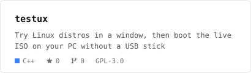

# gh-statcard

A GitHub stats card and repo cards for your profile README, rendered as plain static SVG files.
No server, no dependencies, Node 20 or newer. The cards follow the viewer's light or dark theme.




The stats card shows contributions over the last 12 months (private ones too, if you show them on your profile),
merged pull requests, stars, public repos, one bar per week and your top languages.

## Use it as a GitHub Action

Add `.github/workflows/statcard.yml` to your profile repo (`<you>/<you>`):

```yaml
name: statcard
on:
  schedule:
    - cron: '0 */6 * * *'
  workflow_dispatch:
permissions:
  contents: write
jobs:
  card:
    runs-on: ubuntu-latest
    steps:
      - uses: actions/checkout@v4
      - uses: luxend0/gh-statcard@v1
        with:
          user: your-login
          exclude: HTML,CSS
      - run: |
          git config user.name 'github-actions[bot]'
          git config user.email '41898282+github-actions[bot]@users.noreply.github.com'
          git add stats.svg
          git diff --cached --quiet || { git commit -m 'Update stats card' && git push; }
```

Then put `` in your README.

| Input | Default | |
|---|---|---|
| `user` | | GitHub login, required |
| `out` | `stats.svg` | where to write the SVG |
| `orgs` | | comma-separated orgs whose public repos count toward languages |
| `exclude` | | comma-separated languages to leave out, e.g. `HTML,CSS` |
| `token` | workflow token | token for the GraphQL API |

## Use it from the command line

```sh
GH_TOKEN=<token> node statcard.mjs --user <login> [--orgs a,b] [--exclude HTML,CSS] --out stats.svg
GH_TOKEN=<token> node statcard.mjs --repo <owner/name> --out repo.svg
```

A classic token without any scopes is enough; only public data is read.
Files are written atomically, so a web server never serves half a card.

To self-host, run it on a timer and serve the output directory as static files.
A systemd example:

```ini
# /etc/systemd/system/gh-statcard.service
[Service]
Type=oneshot
User=ghstats
EnvironmentFile=/etc/ghstats/env
ExecStart=/usr/bin/node /opt/gh-statcard/statcard.mjs --user <login> --out /var/www/ghstats/stats.svg
ExecStart=/usr/bin/node /opt/gh-statcard/statcard.mjs --repo <owner/name> --out /var/www/ghstats/repo.svg
ProtectSystem=strict
ReadWritePaths=/var/www/ghstats
NoNewPrivileges=yes

# /etc/systemd/system/gh-statcard.timer
[Timer]
OnBootSec=2min
OnUnitActiveSec=3h
[Install]
WantedBy=timers.target
```

## Tests

```sh
node test.mjs
```

## License

MIT
